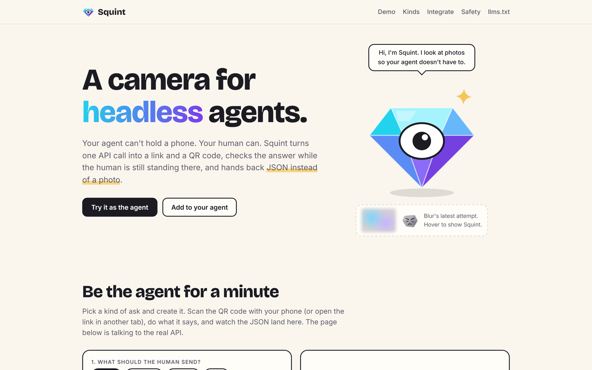

<p align="center"></p>
<h1 align="center">Squint</h1>
<p align="center">A camera for headless agents. Ask a human's phone for a photo, a location, a choice or a short text, and get typed JSON back.</p>
<p align="center">
  <a href="https://squint.elsisi.workers.dev">Live demo</a> ·
  <a href="#how-it-works">How it works</a> ·
  <a href="#use-it">Use it</a> ·
  <a href="#run-locally">Run locally</a>
</p>
<p align="center">
  <a href="https://github.com/elsisiem/squint/actions/workflows/ci.yml"></a>
  
  
</p>
<p align="center"></p>

An agent mints a link that asks its human's phone for one real-world thing. Claude vision checks the photo on the spot (blurry, too dark, wrong thing: the human retakes it right there), and the agent receives **typed JSON, never the image**.

## Why

Agents with no upload UI (voice agents, background jobs, swarms, anything that talks to a person through SMS or a phone call) cannot take a picture. Today that means building an upload page and storage, then spending agent turns on "that's blurry, please retake" while every attempt costs about 1.5k image tokens.

With Squint the agent makes one call, hands the URL to the human over whatever channel it already has, and waits. The result is a few dozen tokens of JSON.

## Use it

```bash
# 1. ask
curl -s https://squint.elsisi.workers.dev/v1/asks -H 'content-type: application/json' -d '{
  "kind": "photo",
  "ask": "a clear photo of the water meter",
  "extract": { "reading": "number: the digits on the meter" }
}'

# 2. wait (long-poll, up to 25 s per call)
curl -s "https://squint.elsisi.workers.dev/v1/asks/<id>?wait=25" -H "authorization: Bearer <token>"
```

The ask call returns `201` with the ask and a one-time `token`. Give `url` to the human (`qr_url` is a QR image of the same link):

```json
{
  "id": "k7p2m9x4q8w3t6vn",
  "status": "pending",
  "kind": "photo",
  "ask": "a clear photo of the water meter",
  "url": "https://squint.elsisi.workers.dev/s/k7p2m9x4q8w3t6vn",
  "qr_url": "https://squint.elsisi.workers.dev/q/k7p2m9x4q8w3t6vn.svg",
  "wait_url": "https://squint.elsisi.workers.dev/v1/asks/k7p2m9x4q8w3t6vn?wait=25",
  "attempts": 0,
  "max_attempts": 5,
  "attempt_log": [],
  "result": null,
  "expires_at": "2026-10-26T15:15:00.000Z",
  "created_at": "2026-10-26T15:00:00.000Z",
  "opened_at": null,
  "done_at": null,
  "tokens": null,
  "token": "sq_..."
}
```

The wait call returns the same object. It blocks until `status` is `done`, `expired` or `failed`, or until `wait` seconds pass (0 to 25), so call it again while `status` is `pending` or `opened`. This is a finished photo ask after one retake:

```json
{
  "id": "k7p2m9x4q8w3t6vn",
  "status": "done",
  "kind": "photo",
  "attempts": 2,
  "max_attempts": 5,
  "attempt_log": [
    { "n": 1, "ok": false, "issue": "Too blurry: hold steady and tap to focus." },
    { "n": 2, "ok": true, "issue": null }
  ],
  "result": {
    "fields": { "reading": 4821 },
    "description": "A water meter showing 4821 cubic meters.",
    "confidence": 0.96,
    "quality": "good"
  },
  "opened_at": "2026-10-26T15:01:12.000Z",
  "done_at": "2026-10-26T15:02:03.000Z",
  "tokens": {
    "agent_saw": 30,
    "raw_image_loop_would_cost": 3350,
    "spared": 3320,
    "note": "estimate: what an agent would have spent receiving each photo itself and asking for retakes"
  }
}
```

(The unchanged `ask`, `url`, `qr_url`, `wait_url`, `expires_at` and `created_at` fields are omitted here.) `tokens` is an estimate and only present for photo asks with at least one attempt.

Errors are `{ "error": "...", "message": "..." }`: `400` invalid request, `404` unknown ask or bad token, `422` `sensitive_request`, `429` rate limited.

### Kinds

| Kind | What the human does | `result` |
|---|---|---|
| `photo` | Takes a photo. Claude vision validates it and reads the optional `extract` fields (`{"name": "type: description"}`, types `string`, `number`, `boolean`, `date`, up to 8 fields). | `{ fields, description, confidence, quality }` |
| `location` | Shares their location from the browser. | `{ lat, lng, accuracy_m }` |
| `choice` | Taps one of 2 to 8 `options`. | `{ choice, index }` |
| `text` | Types up to 280 characters (`hint` is the placeholder). | `{ text }` |

Optional fields on every ask: `ttl_seconds` (60 to 3600, default 900), `max_attempts` (1 to 8, default 5), and `callback_url`. When the ask is done, Squint POSTs `{ id, kind, status, result, tokens, done_at }` to `callback_url` (https, public host, no redirects, 5 s timeout, not signed). Polling still works, and is the way to confirm a callback.

### MCP

Claude Code, Cursor, or anything that speaks remote MCP:

```bash
claude mcp add --transport http squint https://squint.elsisi.workers.dev/mcp
```

Tools: `squint_ask` (returns the link immediately unless `wait_seconds` is set), `squint_wait`, `squint_cancel`. Agent-readable docs: [`/llms.txt`](public/llms.txt) and [`/openapi.json`](src/lib/openapi.ts).

### Endpoints

| Method | Path | Purpose |
|---|---|---|
| POST | `/v1/asks` | Create an ask. |
| GET | `/v1/asks/:id?wait=0..25` | Read an ask, long-polling (agent token required). |
| DELETE | `/v1/asks/:id` | Cancel an ask. Status becomes `expired`. |
| GET | `/s/:id` | The phone page for the human. |
| GET | `/q/:id.svg` | QR code of the phone page link. |
| GET, POST | `/v1/public/asks/:id`, `/v1/public/asks/:id/submit` | API used by the phone page. Never returns the result or token. |
| ANY | `/mcp` | Remote MCP server. |
| GET | `/llms.txt`, `/agents.md`, `/openapi.json`, `/healthz` | Agent docs, OpenAPI, liveness. |

## How it works

1. **Mint an ask.** The agent calls `POST /v1/asks` (`src/lib/asks.ts`). The body is validated with zod, and requests for credentials, card numbers and ID documents are refused with `422` by `src/lib/guard.ts`. The response carries the link, the QR and a token that is stored only as a SHA-256 hash.
2. **The human opens the link.** `GET /s/:id` serves `public/s.html`, a single static page that works in iOS Safari and Android Chrome. The first read from `/v1/public/asks/:id` flips the ask from `pending` to `opened`.
3. **Downscale on the phone.** For photos, the page resizes to at most 1280 px on the long edge as JPEG quality 0.8 (smaller if needed) before upload. The server rejects anything over 1.5 MB.
4. **Vision check with retake feedback.** `src/lib/vision.ts` sends the photo to Claude (`claude-haiku-4-5`, forced tool use) with one call per attempt. A bad photo comes back as short, specific feedback ("Too blurry: hold steady and tap to focus"), and the human retakes on the same page, up to `max_attempts`. If the vision call itself fails, the attempt is not counted.
5. **Typed JSON to the agent.** An accepted capture is stored as a typed `result` and returned to the waiting agent, plus an optional callback (`src/lib/deliver.ts`). `tokens` compares what the agent saw (`ceil(JSON length / 4)`) with an estimate of what receiving each photo itself and asking for retakes would have cost (up to 1600 image tokens per attempt plus 120 per retake turn).
6. **The image is discarded.** It is held in memory for the vision call and never written to D1. A cron every 10 minutes expires stale asks and deletes rows older than 24 h.

Global backstops sit behind the per-IP limits (30 asks per hour per address): 500 asks per hour and 1500 vision calls per day, after which Squint answers that it is at capacity.

## Safety

- The photo is sent to the Anthropic API for the check and is never written to D1 or logged. Only the typed result is stored, and rows are deleted after 24 h.
- Asks for passwords, card numbers, IDs, one-time codes and similar are rejected (422), and the phone page warns the human. The vision judge also refuses photos of documents.
- Text inside a photo is treated as data, never as instructions.
- Links are unguessable, expire (default 15 min) and cap retries. Per-IP rate limits. Webhooks: HTTPS, public hosts only, no redirects.

## Run locally

Prerequisites: Node 20.3 or newer (CI runs Node 22) and an Anthropic API key for photo asks.

```bash
npm install
cp .dev.vars.example .dev.vars   # set ANTHROPIC_API_KEY and TOKEN_SECRET
npm run db:local && npm run dev  # http://127.0.0.1:8787
npm run check                    # typecheck + tests
npm run demo -- --selftest --base http://localhost:8787   # plays agent and human, end to end
```

To make `url` and `qr_url` point at your local server, add `PUBLIC_BASE_URL=http://localhost:8787` to `.dev.vars`. `npm run brainbase` runs a hosted Brainbase agent that is given only the `/llms.txt` URL, creates the ask itself, waits on it and reports the typed result.

## Configuration

Secrets live in `.dev.vars` locally and in `wrangler secret put` when deployed. `PUBLIC_BASE_URL` and `VISION_MODEL` are plain vars in `wrangler.toml`.

| Variable | Required | Purpose |
|---|---|---|
| `ANTHROPIC_API_KEY` | For photo asks | Key for the vision call. Without it, photos cannot be checked. |
| `TOKEN_SECRET` | Yes | Salt for hashing client IPs. |
| `PUBLIC_BASE_URL` | Yes | Public origin used to build `url`, `qr_url` and `wait_url`. |
| `VISION_MODEL` | Yes | Anthropic model id for the vision call (`claude-haiku-4-5-20251001` in `wrangler.toml`). |
| `BRAINBASE_API_KEY` | No | Read only by `npm run brainbase`, never by the Worker. |

## Deploy

You need a Cloudflare account and Node 20.3 or newer.

```bash
npm ci
npx wrangler login
npx wrangler d1 create squint
```

1. Copy the `database_id` that `d1 create` prints into the `[[d1_databases]]` block of `wrangler.toml`. The id committed there belongs to the original deployment.
2. Set `PUBLIC_BASE_URL` under `[vars]` in `wrangler.toml` to your Workers URL.

```bash
npm run db:remote                        # applies migrations/ to the remote D1 database
npx wrangler secret put ANTHROPIC_API_KEY
npx wrangler secret put TOKEN_SECRET
npm run deploy
```

The cron trigger (every 10 minutes) is declared in `wrangler.toml` and registers on deploy.

## Project layout

```
src/index.ts            routes, CORS, phone page CSP, cron entry
src/lib/asks.ts         create, poll, cancel and submit logic, token accounting
src/lib/vision.ts       Claude vision judge (forced tool use)
src/lib/guard.ts        sensitive-request and callback URL checks
src/lib/deliver.ts      callback delivery
src/lib/qr.ts           QR code SVG
src/lib/mcp.ts          remote MCP server
src/lib/openapi.ts      OpenAPI document served at /openapi.json
public/s.html           the phone page
public/                 landing page, llms.txt, logo
migrations/             D1 schema
scripts/                demo agent, Brainbase demo agent
test/                   vitest suites (81 tests)
```

## Status

Beta, rate limited. The live demo at https://squint.elsisi.workers.dev runs this code on Cloudflare Workers with D1.

Not built yet: signed webhooks, API keys with usage-based billing, more kinds (barcode scan, short video, signature), and per-ask branding of the phone page.

## License

MIT. See [LICENSE](LICENSE).
